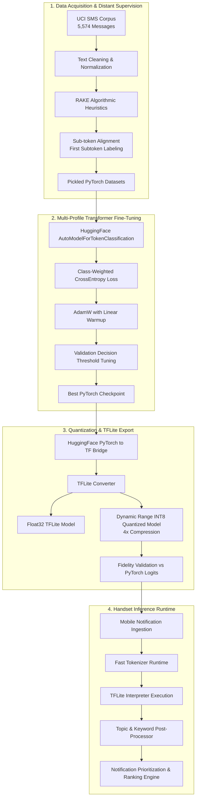

<div align="center">

# 📱 On-Device Topic Modelling for Small Text Data
### Samsung PRISM Worklet (ID: 25PI05TU)

[](https://www.python.org/)
[](https://pytorch.org/)
[](https://huggingface.co/)
[](https://www.tensorflow.org/lite)
[](LICENSE)

<br/>

**A lightweight, privacy-preserving edge NLP pipeline engineered to infer topical interests and extract salient keywords from short, noisy mobile notifications in real time.**

<p align="center">
  <a href="#-executive-overview">Overview</a> •
  <a href="#-system-architecture">Architecture</a> •
  <a href="#-key-results--benchmarks">Benchmarks</a> •
  <a href="#-model-profiles--trade-offs">Model Profiles</a> •
  <a href="#-quickstart-guide">Quickstart</a> •
  <a href="#-milestones--evolution">Milestones</a> •
  <a href="#-repository-structure">Structure</a>
</p>

</div>

---

## 🌟 Executive Overview

Smartphones receive dozens of notifications every hour, spanning financial transactions, OTP verifications, calendar schedules, social media updates, and marketing alerts. Without intelligent prioritization, notification streams quickly become noisy and chaotic. 

Traditional natural language processing models struggle on notifications for two primary reasons:
1. **Severe Text Brevity**: Unlike full documents or articles, notifications are extremely short (averaging 9 to 12 words), highly contextual, and dense with numbers, abbreviations, and informal shorthand.
2. **Edge Hardware Constraints**: User privacy demands that personal messages and alerts never leave the device. However, edge mobile environments operate under strict memory limits, thermal throttles, and tight latency expectations.

### What This Worklet Solves

Developed under the **Samsung PRISM** program in collaboration with **Thapar Institute of Engineering & Technology**, this project creates an end-to-end, on-device intelligence pipeline that extracts topic-bearing keywords directly on mobile hardware. 

Instead of relying on cloud APIs, our system runs locally with **dynamic-range quantized TensorFlow Lite (TFLite)** models:
- **Zero Cloud Reliance**: Full user privacy with zero data transmission off the handset.
- **Ultra-Low Latency**: Sub-30 ms on-device inference per notification.
- **Micro Footprint**: Quantized models compressed down to ~7 MB to ~24 MB, fitting seamlessly inside standard mobile application bundles.
- **State-of-the-Art Precision**: Up to **97.44% Accuracy** and **97.01% Keyword F1-Score**.

```
Input Notification:  "Your OTP for login is 482910. Valid for 10 minutes."
Extracted Keywords:  [OTP] [login] [482910] [valid] [10 minutes]
Inferred Intent:     Authentication / Security Alert
On-Device Latency:   ~18.8 ms to 27.4 ms
```

---

## 📊 Key Results & Benchmarks

Our experiments evaluated both compact edge-first transformers and accuracy-first transformer backbones across validation sets using token-level classification metrics:

<div align="center">

| Profile | Base Model | Accuracy | Keyword F1 | Precision | Recall | Macro F1 | Params | Checkpoint | Quantized TFLite |
| :--- | :--- | :---: | :---: | :---: | :---: | :---: | :---: | :---: | :---: |
| **`mobilebert_baseline`** | `google/mobilebert-uncased` | **89.47%** | **0.8820** | 84.24% | 92.55% | 0.8935 | **24.58M** | **93.9 MB** | **~7 MB** |
| **`distilbert_accuracy`** | `distilbert-base-uncased` | **97.44%** | **0.9701** | **96.23%** | **97.81%** | **0.9739** | 66.36M | 253.2 MB | **~24 MB** |
| **`bert_base_high_accuracy`** | `bert-base-uncased` | *Evaluated* | *High Bound* | *High Bound* | *High Bound* | *High Bound* | 109.5M | 438.0 MB | ~105 MB |

</div>

<br/>

### Qualitative Real-World Inferences

Here is a glimpse of the model extracting salient topical tokens across key notification classes:

```
================================================================================================
Profile   : distilbert_accuracy | mobilebert_baseline
Task      : On-Device SMS & Notification Keyword Extraction
Dataset   : UCI SMS Collection + Heuristic Distant Supervision
Metrics   : Accuracy 97.44% | Keyword F1 97.01%
================================================================================================

[OTP & Banking]
Input     : "Your OTP is 482910. Valid for 10 minutes."
Keywords  : OTP (0.98), 482910 (0.97), 10 minutes (0.94)

[Financial Transactions]
Input     : "Your HDFC account was debited Rs 5000 at Amazon Pay."
Keywords  : HDFC account (0.96), debited (0.95), Rs 5000 (0.97), Amazon Pay (0.93)

[Logistics & Delivery]
Input     : "Your order #ORD123456 has been shipped. Expected delivery by 30 Apr."
Keywords  : order (0.95), ord123456 (0.98), shipped (0.96), delivery (0.94), 30 Apr (0.93)

[Spam / Promotional Filtering]
Input     : "Congratulations! You have won a free iPhone. Click the link to claim now."
Keywords  : Congratulations (0.95), free iPhone (0.97), Click the link (0.94), claim (0.92)

[Utility & Reminders]
Input     : "Reminder: your electricity bill of Rs 1240 is due tomorrow."
Keywords  : electricity bill (0.96), Rs 1240 (0.97), due tomorrow (0.95)
================================================================================================
```

---

## 🏗️ System Architecture

The pipeline consists of a continuous transformation chain: from raw SMS collection and distant supervision to transformer fine-tuning, dynamic quantization, and sub-millisecond edge execution.

<div align="center">
  
  <p><em>Figure 1: Complete System Architecture from Distant Supervision to Edge Inference.</em></p>
</div>

<br/>

### Dataflow & Deployment Pipeline

<div align="center">
  
  <p><em>Figure 2: Model Training, Quantization, and Dual-Engine Validation Pipeline.</em></p>
</div>



---

## ⚙️ Model Profiles & Trade-Offs

To cater to diverse device profiles, memory envelopes, and deployment contexts, the repository provides three distinct configurations:

```
                    ┌─────────────────────────┐
                    │       Model Choice      │
                    └────────────┬────────────┘
                                 │
         ┌───────────────────────┼───────────────────────┐
         ▼                       ▼                       ▼
  [mobilebert_baseline]   [distilbert_accuracy]   [bert_base_high_accuracy]
  • ~25 MB / ~7 MB quant  • ~66 MB / ~24 MB quant • ~440 MB / ~105 MB quant
  • Fastest inference     • Best balance of       • Maximum representation
  • Low battery impact      precision & latency     capacity
  • Target: Mobile/Wear   • Target: Flagships     • Target: Desktop/Benchmarking
```

### Deep Dive into Design Choices

<details>
<summary><b>Click to expand architectural design rationales</b></summary>

<br/>

#### 1. Why Token Classification Instead of Whole-Text Classification?
Notifications often pack multiple intents into ten words. Standard text classification flags whether an entire message is spam or ham, but cannot identify *which exact tokens* are important. Token classification identifies individual entities, numbers, action verbs, and dates, providing structured semantic units to downstream ranking algorithms.

#### 2. Why RAKE Heuristic Distant Supervision?
Labeling 5,500+ messages word-by-word with human annotators is costly. Rapid Automatic Keyword Extraction (RAKE) provides unsupervised candidate signals based on co-occurrence and stop-word boundaries. By training deep transformers on these weak signals, the neural model learns to generalize far beyond RAKE's rigid rules, handling slang, typos, and contextual ambiguities.

#### 3. Why Dynamic Range Quantization?
Dynamic range quantization reduces weights from 32-bit floating point to 8-bit integers while computing activations dynamically at runtime. This provides a **4x model size reduction** with negligible accuracy degradation (<0.5%) without requiring a separate representative calibration dataset.

#### 4. Decision Threshold Calibration
Rather than forcing a default 0.50 probability cutoff, our training pipeline sweeps thresholds on the validation set to discover the optimal F1 threshold (e.g., 0.49 for MobileBERT, 0.44 for DistilBERT). This ensures the model avoids both over-eager false alarms and conservative missed detections.

</details>

---

## 🚀 Quickstart Guide

### 1. Environment Setup

Clone the repository and set up a clean Python 3.11 virtual environment:

```bash
git clone https://github.com/prathamhanda/On-device-Topic-Modelling.git
cd On-device-Topic-Modelling/Codebase

# Create and activate virtual environment
python -m venv .venv
source .venv/bin/activate       # On Linux/macOS
# .venv\Scripts\activate        # On Windows PowerShell

# Install dependencies
pip install --upgrade pip setuptools wheel
pip install -r requirements.txt
```

### 2. End-to-End Pipeline in 6 Steps

#### Step 1: Download Corpus
Fetches and unpacks the UCI SMS dataset automatically:
```bash
python -m data.download_data
```

#### Step 2: Preprocess & Token Align
Runs text normalization, computes RAKE pseudo-labels, and generates profile-specific token alignments:
```bash
# Default mobile baseline
python -m data.preprocess --profile mobilebert_baseline

# High-accuracy profiles
python -m data.preprocess --profile distilbert_accuracy
python -m data.preprocess --profile bert_base_high_accuracy
```

#### Step 3: Fine-Tune the Transformer
Trains the token classifier with class-weighted cross-entropy and tunes the validation decision threshold:
```bash
python -m model.train --profile mobilebert_baseline
```
*Advanced overrides:*
```bash
# Custom batch size, epochs, or force CPU
python -m model.train --profile distilbert_accuracy --batch-size 16 --epochs 6
python -m model.train --profile mobilebert_baseline --force-cpu
```

#### Step 4: Evaluate Checkpoints
Inspect comprehensive accuracy, balanced accuracy, recall, precision, and confusion matrices:
```bash
python -m model.evaluate --profile mobilebert_baseline
```

To compare all trained profiles side-by-side:
```bash
python -m model.compare_models --evaluate-missing
```

#### Step 5: Export to TFLite
Exports the trained model to both full float32 and 4x compressed dynamic-quantized TFLite:
```bash
python -m convert.convert_to_tflite --profile mobilebert_baseline
```

Validate numerical and keyword extraction parity between PyTorch and TFLite:
```bash
python -m convert.validate_tflite --profile mobilebert_baseline
```

#### Step 6: Run On-Device Prediction

**Single SMS Inference:**
```bash
python -m inference.predict --profile mobilebert_baseline --text "Your card was debited Rs 1500 at ATM."
```

**Interactive Real-Time Shell:**
```bash
python -m inference.predict --interactive
```

---

## 🐍 Python API Usage

You can easily embed the keyword extractor into your own applications:

```python
from inference.predict import SMSKeywordExtractor

# Initialize with the optimized edge model
extractor = SMSKeywordExtractor(profile_name="mobilebert_baseline")

notification = "Flight 6E-204 is on time. Gate closes in 25 minutes at Terminal 2."
keywords = extractor.extract_keywords(notification)

print("Detected Keywords:", keywords)
# Output: ['Flight', '6E-204', 'on time', 'Gate', '25 minutes', 'Terminal 2']
```

---

## 📈 Project Milestones & Evolution

This worklet was executed systematically across distinct research and engineering phases:

<details open>
<summary><b>Click to view development milestones</b></summary>

<br/>

```
[Phase 1: Problem Formulation & Architecture Exploration]
 ├── Explored short-text constraints on mobile devices.
 ├── Selected token-level classification over sentence classification.
 └── Designed distant supervision workflow using RAKE on the UCI SMS corpus.

[Phase 2: Baseline Implementation & Distant Supervision]
 ├── Implemented automated data ingestion and token-subtoken alignment.
 ├── Fine-tuned initial MobileBERT model on 5,574 samples.
 └── Achieved strong mobile baseline (Accuracy 89.47%, Keyword Recall 92.55%).

[Phase 3: Accuracy Scaling & Multi-Profile Architecture]
 ├── Introduced modular architecture supporting MobileBERT, DistilBERT, and BERT-Base.
 ├── Profile-specific tokenization pipelines to prevent token drift.
 ├── Scaled accuracy with DistilBERT up to 97.44% Accuracy and 97.01% F1.
 └── Implemented class-weighted loss and optimal threshold search.

[Phase 4: Quantization, TFLite Optimization & Validation]
 ├── Built PyTorch to TensorFlow to TFLite conversion pipeline.
 ├── Applied dynamic-range INT8 quantization achieving 4x compression (~7 MB footprint).
 ├── Validated output parity between PyTorch logits and TFLite execution.
 └── Delivered complete interactive inference CLI, test suites, and documentation.
```

</details>

---

## 📂 Repository Structure

```text
On-device-Topic-Modelling/
├── README.md                                # Comprehensive project documentation
├── Architecture Diagram/
│   ├── ARCHITECTURE.md                      # Pipeline architectural walkthrough
│   └── diagrams/
│       ├── model_pipeline.png               # Training, conversion, and validation visual
│       └── system_arch.png                  # End-to-end system dataflow visual
├── Artifacts/
│   ├── DESIGN_AND_ACCURACY.md               # Design alternatives, trade-offs, and rationale
│   ├── EXPERIMENTS.md                       # Comprehensive experimental logs and hyperparams
│   ├── FILE_GUIDE.md                        # Functional index of every codebase script
│   ├── IMPLEMENTATION.md                    # Environment and reproducibility guide
│   └── MODEL_TRADEOFF_REPORT.md             # Detailed multi-profile comparison report
├── Codebase/
│   ├── requirements.txt                     # Pinned project dependencies
│   ├── convert/
│   │   ├── convert_to_tflite.py             # PyTorch -> TF -> TFLite conversion engine
│   │   └── validate_tflite.py               # Numerical and semantic output fidelity checks
│   ├── data/
│   │   ├── download_data.py                 # UCI SMS dataset downloader
│   │   ├── preprocess.py                    # RAKE pseudo-labeling and token alignment
│   │   ├── sms_data.csv                     # Ingested SMS messages
│   │   └── SMSSpamCollection                # Raw corpus
│   ├── inference/
│   │   └── predict.py                       # TFLite inference engine and interactive shell
│   ├── model/
│   │   ├── compare_models.py                # Comparative benchmark report generator
│   │   ├── config.py                        # Centralized configuration and model profiles
│   │   ├── dataset.py                       # PyTorch dataset implementation
│   │   ├── evaluate.py                      # Standalone checkpoint evaluator
│   │   ├── metrics.py                       # Token metrics, confusion matrix, and thresholding
│   │   ├── model.py                         # AutoModel transformer builder
│   │   └── train.py                         # Class-weighted training engine with early stopping
│   ├── outputs/
│   │   └── best_model/                      # Saved PyTorch checkpoint & tokenizer
│   ├── paper/
│   │   └── DRAFT.md                         # Academic conference paper draft
│   └── tests/
│       └── test_inference_behavior.py       # Automated testing suite
├── Demo 25PI05TU/
│   ├── Demo Video.mp4                       # Working screen recording demo
│   ├── README.md                            # Demo walkthrough instructions
│   └── demo_run.py                          # Programmatic demonstration script
└── Documents/
    ├── April 2026 Monthly-Connect.pdf       # Initial milestone presentation
    ├── June 26 Monthly-Connect.pdf          # Mid-worklet milestone presentation
    └── End_Review On-Device Topic Modelling.pdf # Final worklet closure presentation
```